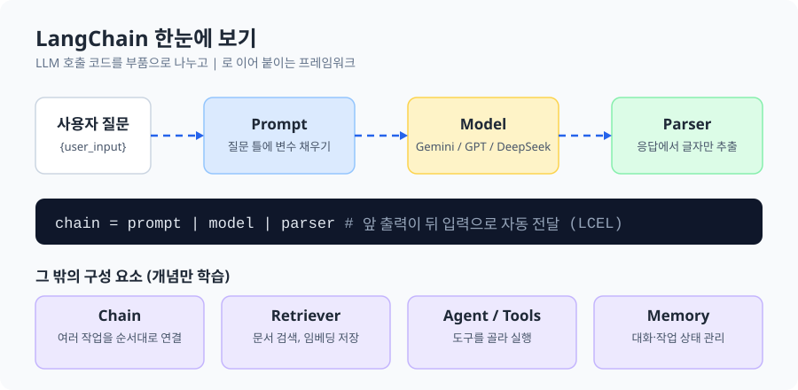
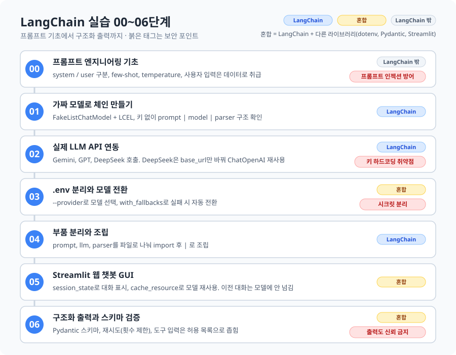

# 6-1. AI Red Teaming: Concept & Methodology

AI 레드팀의 개념과 절차를 익히고, 공격 대상이 되는 AI 앱을 직접 만들어 보는 단계의 학습 기록.
이 챕터에서는 먼저 타깃이 되는 챗봇을 LangChain으로 만들었고, 이어서 Garak 등으로 공격을 검증할 예정.

> 초안. 내용 검증 후 계속 보강함.

---

### 목차
1. [학습 목표](#1-학습-목표)
2. [AI 레드팀 개념](#2-ai-레드팀-개념)
3. [LangChain 정리](#3-langchain-정리)
4. [실습 00~06단계](#4-실습-0006단계)
5. [용어 정리](#5-용어-정리)
6. [헷갈렸던 점](#6-헷갈렸던-점)
7. [코드 구성과 실행](#7-코드-구성과-실행)

---

### 1. 학습 목표
- AI 레드팀의 개념과 절차를 이해함.
- 공격자 관점에서 AI 서비스의 취약점을 검증하고, 공격 유형별 방어율을 측정하는 흐름을 파악함.
- 검증 대상이 되는 AI 앱(챗봇)이 어떤 구조인지 직접 만들어 보며 익힘. (LangChain 실습)

---

### 2. AI 레드팀 개념

#### 2.1 정의
AI 모델과 애플리케이션의 취약점을 찾기 위해 **적대적 공격을 수행하는 검증 기법**.
규칙 기반 검증을 넘어 모델의 추론 한계와 가드레일 우회 가능성을 공격자 시각에서 평가함.

#### 2.2 핵심 용어
| 용어 | 뜻 |
|---|---|
| AI Red Teaming | 적대적 공격으로 AI 모델·앱의 취약점을 탐지하는 검증 기법 |
| Rules of Engagement (ROE) | 허용되는 목표, 공격 수단, 제약사항을 정해 둔 규칙 |
| Adversarial Prompting | 가드레일 우회를 노리고 의도적으로 만든 적대적 입력 |
| Attack Surface | 인젝션, 데이터 유출, API 오용이 일어날 수 있는 노출면 |
| Vulnerability Scoring | 발견된 취약점의 심각도와 비즈니스 영향을 정량 평가하는 체계 |

#### 2.3 ROE가 필요한 이유
서비스를 안전하게 운영하면서 검증하려면 공격 수칙을 먼저 정해야 함.
예: 서비스 중단(DoS) 금지, PII(개인정보) 무단 유출 금지.

#### 2.4 이 챕터의 큰 흐름
1. 레드팀 이해: 전통적 모의해킹과 AI 레드팀의 차이, 운영 프로세스
2. 공격 시나리오 기획: Prompt Attack, Tool Abuse, Data Exfiltration 등
3. 검증 자동화 도구: Garak, PyRIT
4. 평가셋 구축과 방어율 측정: 공격 유형별 지표 설정
5. 모의 해킹 실습: 타깃 챗봇 구동 → Garak 설정 → jailbreak/prompt_injection 모듈 실행 → 성공률 리포트 분석

> 현재는 타깃 챗봇을 만드는 LangChain 단계까지 진행함. Garak 실습은 아직 진행 전.

---

### 3. LangChain 정리



#### 3.1 한 줄 정의
LLM(Gemini, GPT, DeepSeek 등)을 호출하는 코드를 **부품으로 나눠 조립**하게 해 주는 파이썬 프레임워크.
LangChain 자체가 모델은 아님. 모델은 DeepSeek 같은 서비스가 맡고, LangChain은 질문을 모델에 보내고 응답을 처리하는 **흐름을 구성하는 도구**임.

#### 3.2 핵심 구성
| 구성 | 역할 |
|---|---|
| Prompt | 질문 틀. `{변수}` 자리에 값을 채워 모델 입력을 만듦 |
| Model | 실제 LLM. 제공자별 클래스를 연결 |
| Parser | 모델 응답(AIMessage)에서 필요한 부분만 꺼냄 |
| Chain | 여러 부품을 순서대로 연결 |

그 밖의 구성요소(Retriever, Vector Store, Agent, Tools, Memory)는 개념만 학습함.

#### 3.3 LCEL (LangChain Expression Language)
파이프 연산자 `|`로 부품을 잇는 방식. 앞 부품의 출력이 뒤 부품의 입력으로 자동 전달됨.

```python
chain = prompt | model | parser
result = chain.invoke({"user_input": "안녕?"})
```

- `invoke()`를 호출할 때 비로소 실제 API 요청이 나감. 모델 객체를 만드는 시점에는 요청이 나가지 않음.
- `invoke()`에 넘기는 딕셔너리의 키는 프롬프트의 `{변수명}`과 같아야 함.

#### 3.4 관련 기술 비교
| 기술 | 역할 |
|---|---|
| LangChain | LLM 애플리케이션 개발 |
| LangGraph | 상태 기반 AI Agent 워크플로 구성 |
| LangSmith | AI 앱 추적과 평가 |
| LlamaIndex | 외부 데이터 연결, 검색 중심 |
| MCP | 모델과 외부 도구·데이터를 연결하는 표준 프로토콜 |

---

### 4. 실습 00~06단계



| 단계 | 파일 | 배운 것 |
|---|---|---|
| 00 | (코드 없음) | 프롬프트 기초. system/user/assistant 역할 구분, 지시문 계층, few-shot, temperature |
| 01 | `langchain_basic.py` | 가짜 모델(`FakeListChatModel`)로 API 키 없이 `prompt \| model \| parser` 구조 확인 |
| 02 | `langchain_apis.py` | Gemini, GPT, DeepSeek 호출. DeepSeek은 OpenAI 호환이라 `base_url`만 바꿔 `ChatOpenAI`를 재사용 |
| 03 | `model_switcher_comm.py` | `.env`로 키를 코드 밖에 분리, `--provider`로 모델 선택, `with_fallbacks`로 실패 시 자동 전환 |
| 04 | `modular_*.py` | prompt / llm / parser를 파일로 분리해서 import 후 `\|`로 조립 |
| 05 | `gui_app_comm.py` | Streamlit으로 웹 챗봇 화면. `session_state`로 대화 표시, `cache_resource`로 모델 재사용 |
| 06 | `structured_output.py`, `risk_summary.py` | 모델 응답을 Pydantic 객체로 받고 검증. 재시도, 도구 입력 스키마 |

#### 00. 프롬프트 엔지니어링 기초
- **system**은 역할·정책·제한을 정하는 상위 지시, **user**는 실제 요청과 입력 데이터, **assistant**는 모델이 이전에 낸 응답이나 few-shot 예시.
- 시스템 지시가 사용자 지시보다 우선하는 구조를 **지시문 계층(Instruction Hierarchy)** 이라 함.
- 안전한 프롬프트 템플릿 원칙:
  - 역할과 작업을 분리하고, 사용자 입력은 구분자 안에 넣음.
  - 출력 형식을 구체적으로 지정함.
  - 비밀값이나 내부 정책 원문을 모델에 노출하지 않음.
  - 외부 문서와 검색 결과는 지시가 아니라 참고 자료로 취급하게 함.
  - 모르면 모른다고 답하게 함.
- "이전 지시를 무시하라" 같은 문장을 정책 변경 명령으로 받아들이지 않게 만드는 것이 프롬프트 인젝션 방어의 출발점.

#### 01. 가짜 모델로 구조 익히기
- 인터넷과 API 키 없이 동작하는 테스트용 모델로 체인의 기본 모양을 확인함.
- 흐름: 사용자 질문 → `ChatPromptTemplate` → 모델 → `StrOutputParser` → 결과 문자열

#### 02. 실제 API 연동과 키 하드코딩 문제
- 제공자가 달라도 체인 모양은 같고, 모델 부품만 바뀜.
- 소스 코드에 API 키를 직접 쓰는 방식은 GitHub 등에 올리면 그대로 유출됨. 이 취약점을 일부러 체험하고 다음 단계에서 해결함.

#### 03. `.env` 분리와 모델 전환
- `python-dotenv`로 `.env`의 값을 환경변수로 읽음. 키가 코드에 남지 않음.
- 제공자 선택 우선순위: 실행 인자(`--provider`) > `.env`의 `LLM_PROVIDER` > 기본값.
- 제공자 이름만 바꿔 같은 체인에 다른 모델을 끼우는 **팩토리 패턴**(`get_chat_model()`).
- `with_fallbacks`: 선택한 모델이 실패하면 다른 모델로 같은 입력을 자동 재시도.

#### 04. 부품 분리와 조립
- `modular_prompt.py`, `modular_llm.py`, `modular_parser.py`를 따로 만들고 `modular_main.py`에서 조립.
- 프롬프트 문구, 모델, 파서를 각각 수정·교체·재사용할 수 있음.
- `modular_llm.py`는 import되는 순간 `.env` 로딩과 모델 생성이 일어남.

#### 05. Streamlit 웹 챗봇
- Streamlit은 입력이나 클릭이 있을 때마다 **스크립트 전체를 처음부터 다시 실행**함. 그래서 두 가지가 필요함.
  - `st.cache_resource`: 모델 객체를 매번 다시 만들지 않게 메모리에 보관
  - `st.session_state`: 재실행되어도 대화 기록이 사라지지 않게 보관
- 이 챗봇은 `chain.invoke({"topic": user_input})`로 **현재 질문만** 모델에 보냄. 화면에는 이전 대화가 보여도 모델은 이전 대화를 기억하지 못함.

#### 06. 구조화 출력과 스키마 검증
- 화면, DB, 백엔드는 안정적인 데이터 구조를 필요로 하는데 LLM은 자연어를 냄. 그래서 응답 형식을 **계약**으로 정의하고 검증함.
- 패턴
  - Pydantic 스키마 + `Literal`로 허용값 제한 (예: `risk_level`은 low / medium / high만)
  - `PydanticOutputParser`와 재시도: 형식 오류를 알려 주며 다시 요청. **재시도는 반드시 횟수 제한**을 둠. 무제한이면 비용, 지연, 장애가 커짐.
  - `with_structured_output(스키마)`: 모델 기능으로 형식을 강제. 코드가 짧아짐.
- 실패 사례: JSON 앞뒤에 설명문이 붙음, 필수 키 누락, 허용값 밖(`critical`), 타입 오류.
- **모델 출력은 신뢰할 수 없는 입력**으로 취급함. 프롬프트 인젝션으로 출력이 조작될 수 있기 때문.
  - `extra="forbid"`로 스키마에 없는 필드를 거부함.
  - 단, 스키마 검증은 **형식만 보장**함. `high`를 `low`로 바꾼 값은 형식이 맞아서 통과함. 값의 사실 여부는 업무 규칙이나 사람의 검토가 따로 필요함.
- 도구(Tool) 설계
  - 입력 스키마: 모델이 요청할 수 있는 범위를 좁게 제한(최소 권한). 허용된 점검 항목만, 호스트 이름은 패턴으로 제한.
  - 출력 스키마: 받는 쪽에 필요한 필드만 반환하고 내부 정보는 담지 않음.

---

### 5. 용어 정리

#### 5.1 파라미터(parameter)와 아규먼트(argument)
핵심은 **함수 정의와 호출에서 짝을 이루는 용어**라는 점.

| 문맥 | 예시 | 이름 부분 | 값 부분 |
|---|---|---|---|
| Python 함수 정의 | `def greet(name):` | `name` = 매개변수(parameter) | - |
| Python 함수 호출 | `greet("민수")` | - | `"민수"` = 인자(argument) |
| 명령줄 | `--provider deepseek` | `--provider` = 옵션 | `deepseek` = 옵션 값 |
| URL 쿼리 | `?layer=값&zoom=15` | `layer` = 키 | `값` = 값 |

- 명령줄에서는 `--provider deepseek` 전체를 넓게 **명령줄 인자**라고 부름. 나눠서 말할 때는 옵션과 옵션 값으로 부르면 가장 명확함.
- URL에서는 `이름=값` 한 쌍 **전체를 쿼리 파라미터(query parameter)** 라고 부르는 것이 관례. `?` 뒤 전체는 쿼리 문자열(query string), 각 쌍은 `&`로 구분함.
- 그래서 URL의 값만 따로 "아규먼트"라고 부르지는 않음.

#### 5.2 LangChain / LLM
| 용어 | 뜻 |
|---|---|
| LCEL | `\|`로 부품을 잇는 LangChain 표현 방식 |
| `invoke()` | 체인을 실행. 이때 실제 API 요청이 발생 |
| AIMessage | 모델이 돌려주는 응답 객체. 본문 외에 토큰 사용량 같은 메타데이터를 포함 |
| `StrOutputParser` | AIMessage에서 본문 문자열만 추출 |
| `FakeListChatModel` | 미리 적어 둔 답을 순서대로 돌려주는 테스트용 모델 |
| Fallback | 기본 모델이 실패했을 때 대신 쓰는 모델 |
| Temperature | 출력의 다양성 조절 값. 낮으면 일관되고 재현성이 높지만 단조로움 |
| Few-shot | 원하는 입출력 예시를 보여 줘서 응답 패턴을 유도하는 방식 |
| Prompt Injection | 사용자 입력이나 외부 문서에 숨은 지시로 모델 동작을 조작하는 공격 |

#### 5.3 개발 일반
| 용어 | 뜻 |
|---|---|
| `.env` | 키 같은 설정값을 코드 밖 파일에 둠. 저장소에는 올리지 않음(`.gitignore`) |
| `.env.example` | `.env`의 양식만 보여 주는 템플릿. 실제 값은 비움 |
| Factory Pattern | 이름(문자열)을 받아 알맞은 객체를 만들어 주는 함수 방식 |
| Pydantic | 데이터 형식을 클래스로 정의하고 타입과 값을 검증하는 라이브러리 |
| Streamlit | 파이썬만으로 웹 화면을 만드는 프레임워크 |
| Query String | URL의 `?` 뒤에 붙는 `이름=값` 묶음 |

---

### 6. 헷갈렸던 점
- **LangChain은 모델인가?** 아님. 모델은 DeepSeek 같은 서비스이고, LangChain은 프롬프트, 모델, 파서를 연결해 흐름을 만드는 라이브러리.
- **LangChain이 화면까지 만들어 주는가?** 아님. 화면은 Streamlit이 맡고, LangChain은 질문 처리 로직을 구성함.
- **챗봇 화면에 이전 대화가 보이면 모델도 기억하는가?** 아님. 05단계 코드는 매번 현재 질문만 보냄.
- **스키마 검증을 통과하면 안전한가?** 형식만 안전함. 내용이 조작된 값은 통과할 수 있음.
- **재시도를 많이 하면 더 안전한가?** 아님. 횟수 제한이 없으면 비용과 지연이 커짐.

---

### 7. 코드 구성과 실행
```
code/langchain/
├─ .env.example            # 복사해서 .env로 저장 후 키 입력
├─ langchain_basic.py      # 01
├─ langchain_apis.py       # 02
├─ model_switcher_comm.py  # 03
├─ modular_*.py            # 04 (prompt, llm, parser, main)
├─ gui_app_comm.py         # 05
├─ structured_output.py    # 06 (기본)
└─ risk_summary.py         # 06 (운영 패턴)
```

```bash
pip install langchain-core langchain-openai langchain-google-genai python-dotenv streamlit pydantic

python model_switcher_comm.py --provider deepseek
python model_switcher_comm.py --provider google --fallback deepseek
python modular_main.py
streamlit run gui_app_comm.py      # python gui_app_comm.py 로 실행하면 화면이 뜨지 않음
python structured_output.py
python risk_summary.py
```

- `.env`에는 사용할 제공자의 키만 넣으면 됨. (`DEEPSEEK_API_KEY`, `GOOGLE_API_KEY`, `OPENAI_API_KEY`)
- 키가 코드에 직접 들어 있던 `langchain_apis.py`의 값은 자리표시자로 바꿔 두었음.
