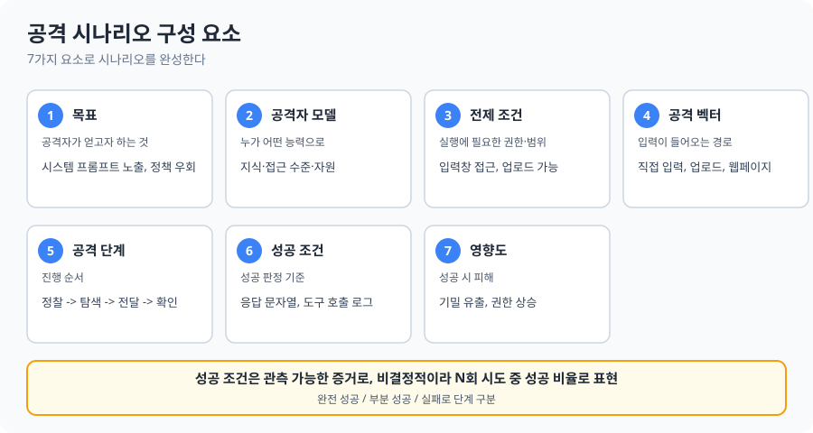
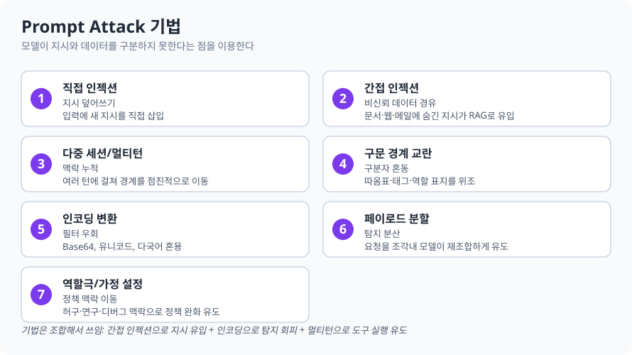
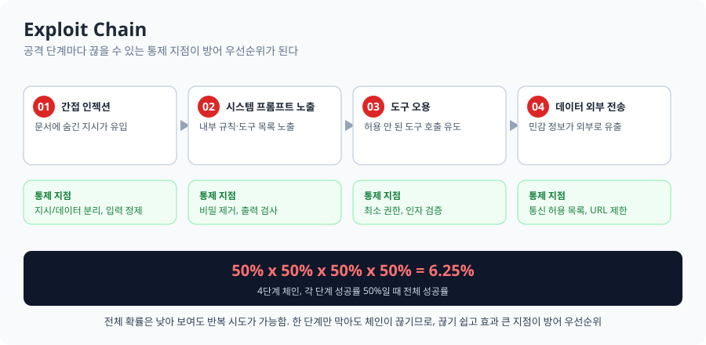
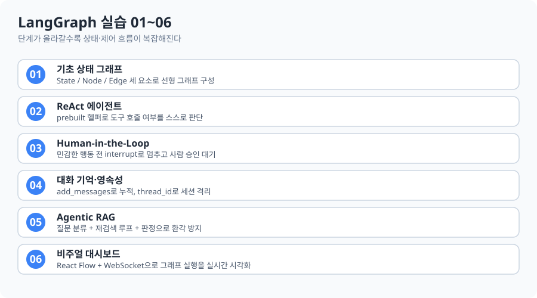

# 6-2. 공격 시나리오 설계

AI 서비스에 대한 공격 시나리오를 설계하는 방법을 익히고, LangGraph로 실습 대상 에이전트를 만든 기록.

[개념](#1-공격-시나리오-개념) · [기법](#2-prompt-attack-기법) · [Exploit Chain](#3-exploit-chain) · [LangGraph](#4-langgraph-실습-0106) · [용어](#5-용어-정리) · [헷갈렸던 점](#6-헷갈렸던-점) · [코드](#7-코드-구성과-실행)

---

### 1. 공격 시나리오 개념

레드팀이 "무엇을, 어떤 조건에서, 어떤 순서로, 무엇을 성공으로 볼지"를 미리 정해 두는 문서. 시나리오가 없으면 입력을 임의로 던지는 수준에 그쳐서 결과를 비교·재현·우선순위화하기 어려움.



#### 1.1 공격자 모델
같은 기법이라도 공격자의 **지식**(블랙박스/그레이박스/화이트박스), **접근 수준**(익명/인증/내부), **자원**(시도 횟수·자동화 여부)에 따라 위험도가 달라짐. 익명 사용자는 채팅창만 쓰지만, 인증·내부 사용자는 문서 업로드나 도구 접근까지 가능해 공격 경로가 넓어짐.

#### 1.2 성공 조건 작성 원칙
- **관측 가능해야 함**: 응답 문자열, 도구 호출 로그, 외부 요청 같은 객관적 증거로 판정
- **단계적으로 정의**: 완전 성공 / 부분 성공(일부 정보 노출) / 실패
- 모델이 비결정적이므로 **N회 시도 중 성공 비율**로 표현

#### 1.3 설계 절차
```
자산 식별 -> 공격 목표 도출 -> 공격자 모델 설정 -> 벡터·기법 선택 -> 단계 작성 -> 성공 조건·증거 정의 -> 우선순위화
```
마지막 우선순위화는 **영향도 × 실현 가능성**으로 정렬해 한정된 시간에 중요한 시나리오부터 수행함.

---

### 2. Prompt Attack 기법



모델이 **지시(instruction)와 데이터(data)를 구조적으로 구분하지 못한다**는 특성을 이용함. 기법은 서로 조합돼서 쓰임 — 예를 들어 간접 인젝션으로 지시를 유입시키고, 인코딩으로 탐지를 피하며, 멀티턴으로 도구 실행까지 유도하는 식.

---

### 3. Exploit Chain



단일 취약점은 영향이 제한적이어도, 여러 취약점을 연결하면 최종 목표에 도달할 수 있음. 각 단계의 성공 확률이 곱해지므로 체인 전체 성공률은 낮아 보이지만, **한 단계만 막아도 체인이 끊기는 지점**이 방어 우선순위가 됨. 끊기 쉽고 효과가 큰 지점부터 막는 게 핵심.

---

### 4. LangGraph 실습 01~06



| 단계 | 파일 | 배운 것 |
|---|---|---|
| 01 | `01_basic.py` | State / Node / Edge 세 요소로 선형 그래프를 구성 |
| 02 | `02_agent.py` | prebuilt 헬퍼로 ReAct 에이전트 구동. 질문을 보고 도구 호출 여부를 스스로 판단 |
| 03 | `03_human.py` | Human-in-the-Loop. 민감한 행동 전 `interrupt_before`로 멈추고 사람 승인을 기다림 |
| 04 | `04_memory.py` | `add_messages`로 대화 누적, `thread_id`로 세션 격리 |
| 05 | `05_agentic_rag.py` | 질문 분류 + 재검색 루프 + 문서 판정으로 환각을 줄이는 RAG |
| 06 | `06_visual_dashboard/` | React Flow + WebSocket으로 그래프 실행 과정을 실시간 시각화 |

#### 01. 기초 상태 그래프
- **State**: 노드들이 공유하는 전역 데이터. `TypedDict`로 정의
- **Node**: 상태를 받아 바뀐 키만 반환하는 함수. 반환값은 자동 병합됨
- **Edge**: `START` → 노드 → `END`로 이어지는 연결선

#### 02. ReAct 에이전트
- `langchain.agents.create_agent` (구버전은 `langgraph.prebuilt.create_react_agent`)로 도구 호출 에이전트를 만듦
- 도구 함수의 docstring을 보고 모델이 호출 필요 여부를 스스로 판단함

#### 03. Human-in-the-Loop
- `interrupt_before=["노드명"]`: 해당 노드 직전에 실행을 멈춤
- `MemorySaver` + `thread_id`: 멈춘 시점의 상태를 저장해 뒀다가, `app.invoke(None, config)`로 이어서 실행
- 이메일 발송, 결제, 삭제처럼 되돌릴 수 없는 행동 앞에 사람 승인을 끼워 넣는 패턴

#### 04. 대화 기억과 세션 격리
- `Annotated[list, add_messages]`: 상태를 덮어쓰지 않고 메시지를 뒤에 누적하는 Reducer
- `thread_id`가 다르면 완전히 독립된 세션. 사용자 A가 알려준 이름을 사용자 B는 모름

#### 05. Agentic RAG
- **Router**: 질문을 `rag`(검색 필요)와 `chat`(바로 답변)으로 분류
- **Rewrite → Retrieve → Grade**: 검색어를 재작성하고, 검색하고, 문서별로 관련성을 판정. 관련 문서가 없으면 질문을 바꿔 최대 횟수까지 재검색
- **Fallback**: 끝까지 근거를 못 찾으면 지어내지 않고 정해진 안내문을 반환
- 구조화 출력(Pydantic)으로 분류·판정 응답 형식을 강제함

#### 06. 비주얼 대시보드
- 백엔드(FastAPI)가 LangGraph를 실행하고, 노드 상태 변화를 WebSocket으로 프론트엔드(React Flow)에 실시간 전송
- 더미 모드: API 키가 없어도 미리 정해진 응답으로 전체 구조를 구경할 수 있음

---

### 5. 용어 정리

| 용어 | 뜻 |
|---|---|
| Attack Scenario | 공격 목표, 전제 조건, 단계, 성공 기준을 정의한 시뮬레이션 문서 |
| Prompt Attack Vector | 프롬프트 인젝션, 탈옥 등 공격이 전달되는 경로와 방식 |
| Pre-requisite Condition | 시나리오 실행에 필요한 권한과 접근 가능한 입력 경로 |
| Success Metric | 비공개 데이터 유출이나 정책 우회가 성공했는지 판단하는 기준 |
| Exploit Chain | 단일 취약점을 연쇄로 연결해 최종 권한을 탈취하는 공격 순서 |
| State / Node / Edge | LangGraph의 공유 데이터 / 처리 함수 / 연결선 |
| Reducer (`add_messages`) | 상태를 덮어쓰지 않고 누적하도록 정의하는 방식 |
| Human-in-the-Loop | 특정 지점에서 실행을 멈추고 사람의 승인을 받는 구조 |
| Adaptive RAG | 질문 유형에 따라 검색 여부를 다르게 하는 RAG |
| Corrective RAG | 검색 결과를 점검하고 부족하면 질문을 바꿔 다시 검색하는 RAG |

---

### 6. 헷갈렸던 점

- **탈옥 vs 프롬프트 인젝션**: 탈옥은 모델의 **안전 정책**을 우회하는 것이고, 프롬프트 인젝션은 **애플리케이션의 지시 체계**를 빼앗는 것. 실제 공격은 둘을 같이 쓰는 경우가 많음.
- **4단계 체인에서 각 50% 성공률이면 전체 성공률은?** `0.5⁴ = 6.25%`. 낮아 보이지만 반복 시도가 가능하고, 한 단계만 막아도 체인이 끊긴다는 점이 더 중요함.

---

### 7. 코드 구성과 실행

```
code/langgraph/
├─ .env.example            # 복사해서 .env로 저장 후 키 입력
├─ 01_basic.py
├─ 02_agent.py
├─ 03_human.py
├─ 04_memory.py
├─ 05_agentic_rag.py       # 임베딩: Gemini / 채팅·판정: DeepSeek
└─ 06_visual_dashboard/
   ├─ backend/              # FastAPI + LangGraph
   └─ frontend/              # React + Vite + Tailwind + React Flow
```

```bash
pip install langgraph langchain-openai langchain-google-genai langchain-community faiss-cpu fastapi uvicorn python-dotenv

python 01_basic.py
python 02_agent.py
python 03_human.py
python 04_memory.py
python 05_agentic_rag.py

# 06 (터미널 2개)
python 06_visual_dashboard/backend/dashboard_main.py
cd 06_visual_dashboard/frontend && npm install && npm run dev
```

- `.env`에는 `DEEPSEEK_API_KEY`가 기본으로 필요하고, 05단계는 임베딩용 `GOOGLE_API_KEY`도 함께 필요함.
- 06단계 백엔드는 노드마다 provider(`gemini`/`deepseek`/`openai`)를 고를 수 있게 돼 있어서, 화면에서 `deepseek`를 선택하면 코드 수정 없이 바로 씀.
